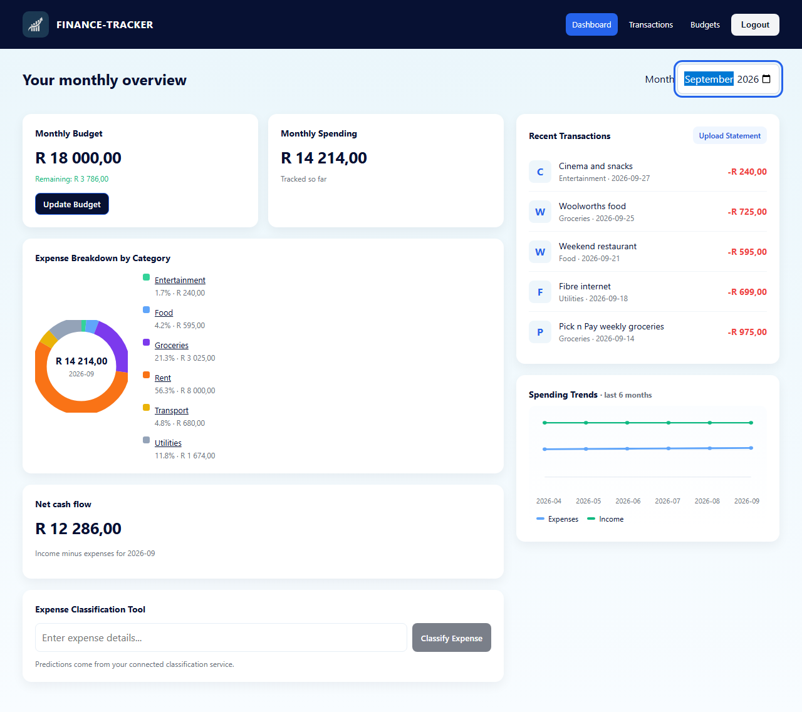
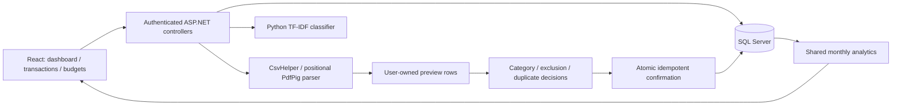
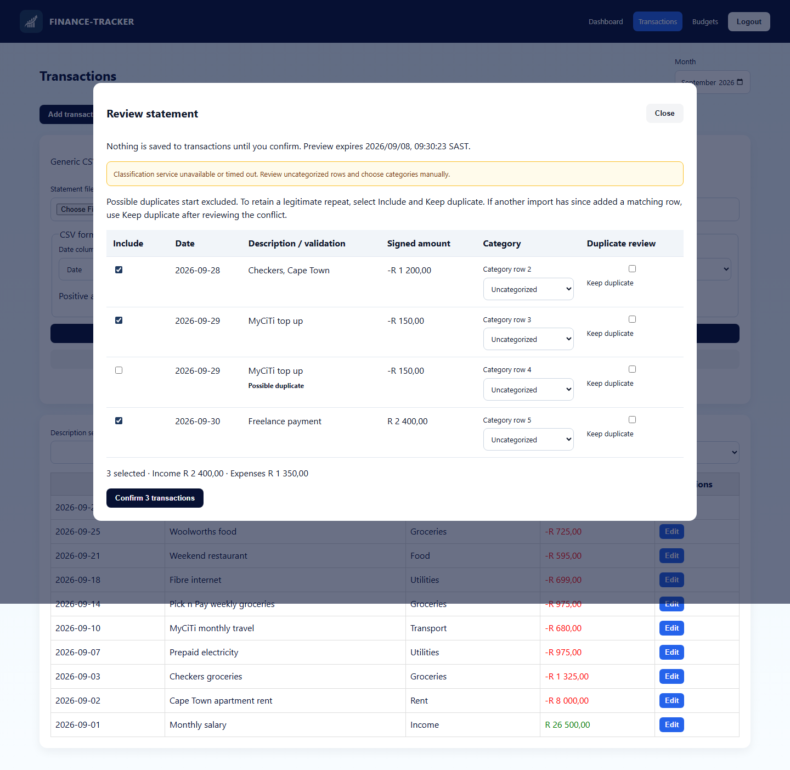
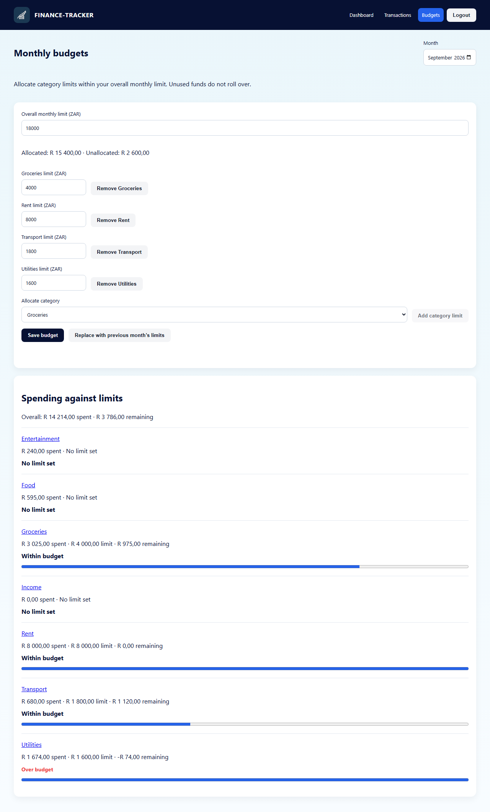

# Finance Tracker — statement review and monthly budgets

A South African personal-finance portfolio application: import a statement, review categories and possible duplicates, confirm transactions, and understand monthly spending against budgets.

React/TypeScript + ASP.NET Core 8 + SQL Server + a Python transaction classifier. All amounts are ZAR. Positive amounts are inflows; negative amounts are expenses. Income minus expenses is **net cash flow**.



## Run locally

Prerequisites: .NET 8 SDK (a newer SDK with .NET 8 runtime also works), Node 22+, Python 3.11, and SQL Server 2022/Express. The commands below run from the repository root in PowerShell. Use three terminals for the API, classifier and frontend.

### 1. Database and API

Use a separate demo database so existing financial data stays separate:

```powershell
$env:ConnectionStrings__DefaultConnection = 'Server=localhost\SQLEXPRESS;Database=FinanceTrackerPortfolioDemo;Trusted_Connection=True;TrustServerCertificate=True'
$env:ASPNETCORE_ENVIRONMENT = 'Development'
$env:Jwt__Key = 'local-demo-only-replace-with-a-long-random-key'
$env:Classifier__BaseUrl = 'http://127.0.0.1:8000/'
dotnet tool restore
dotnet run --project FinanceTracker.Api -c Release --no-launch-profile -- --demo-seed
dotnet run --project FinanceTracker.Api -c Release --no-launch-profile -- --urls http://127.0.0.1:5260
```

The explicit `--demo-seed` command applies migrations and creates `portfolio-demo` / `Demo-Rands-2026!` with 60 synthetic transactions and six months of limits, April–September 2026. Repeating it leaves an existing demo user unchanged. For an empty database, use `--migrate` instead. Runtime startup does not automatically migrate or seed.

For SQL authentication, replace the connection string with `Server=localhost,1433;Database=FinanceTrackerPortfolioDemo;User Id=sa;Password=<your-password>;TrustServerCertificate=True`. SQL Server must already be running. JWT settings can also be provided as `Jwt__Issuer` and `Jwt__Audience`; their defaults match the frontend. The checked-in key is for local development only. Public hosting is outside this release.

Existing databases: `StatementReviewAndCategoryBudgets` preserves budget amounts and marks every historical budget for reconfirmation. If duplicate monthly budgets already exist, migration stops with a clear error; reconcile those records explicitly before rerunning. No amount is guessed or discarded. Transaction timestamps become SQL calendar dates, preserving the stored date part without a timezone conversion.

### 2. Python classifier

```powershell
python -m venv .venv
.\.venv\Scripts\python.exe -m pip install -r finance-tracker-model/requirements-lock.txt
.\.venv\Scripts\python.exe -m uvicorn api:app --app-dir finance-tracker-model --host 127.0.0.1 --port 8000
```

Activation is optional. If desired: `Set-ExecutionPolicy -Scope Process -ExecutionPolicy RemoteSigned`, then `& .\.venv\Scripts\Activate.ps1`.

The saved TF-IDF/logistic-regression model is retained. scikit-learn 1.3.2 matches the version embedded in those artifacts. Model paths resolve relative to the Python service, so startup works from the repository root. `GET /health` reports readiness.

### 3. Frontend

```powershell
npm.cmd --prefix finance-tracker-frontend ci
$env:VITE_API_TARGET = 'http://127.0.0.1:5260'
npm.cmd --prefix finance-tracker-frontend run dev -- --host 127.0.0.1 --port 5174
```

Open [the local app](http://127.0.0.1:5174), sign in with the demo credentials, and select **September 2026**. Vite proxies `/api` to ASP.NET, so no browser CORS configuration is required. Linux/macOS equivalents use `export NAME=value`, `.venv/bin/python`, and `npm`.

## Five-minute walkthrough

1. Dashboard: select September 2026. Show ZAR spending, category breakdown, net cash flow and six-month trends.
2. Transactions → Import statement: choose [demo/import-example.csv](demo/import-example.csv). Keep ISO dates and the default Date/Description/Amount columns.
3. Preview: show editable category suggestions, signed amounts and selected totals. The second identical MyCiTi purchase starts excluded. Include it with **Keep duplicate** only if it represents a legitimate second purchase.
4. Confirm: transactions appear immediately. Monthly limits remain unchanged.
5. Budgets: edit the overall limit and category allocations. The server rejects allocations exceeding the overall limit. Show remaining amounts and textual overspending status.
6. Dashboard: click Groceries to open transactions filtered to the selected month/category; search a description or edit an amount/date/category.
7. Stop the classifier or point `Classifier__BaseUrl` to an unused port and restart the API. Preview still works, with an outage notice and editable uncategorized rows.

A fresh user with a R5,000 limit and an imported R1,200 expense sees **R5,000 limit, R1,200 spent, R3,800 remaining**.

## Transaction recovery, bulk editing and category rules

- Manual entry and editing use **Income (money in)** or **Expense (money out)** with a positive ZAR amount. The API applies the sign; statement imports retain their original signed amounts. Existing signed-amount API clients remain supported when `type` is omitted.
- Select individual transactions or use the table checkbox to select up to 5,000 matching rows. Apply a category to the selection, or delete the selection together. Selections clear when filters or results change. Bulk requests validate ownership and availability for the entire selection before saving any changes.
- Deletion is recoverable: **Undo deletion** restores the latest selection, and **View → Deleted transactions** supports recovery after a reload or later sign-in. The same date/category/search filters apply. Deleted records are retained indefinitely, preserve import provenance, and are excluded from active transactions, spending, budget summaries, net cash flow and duplicate checks. Restoring puts the original records back into those calculations. Confirming an already confirmed import never resurrects deleted records.
- **Category rules** supports creating, editing, disabling and deleting personal rules such as `Checkers → Groceries`. Matching uses case-insensitive description substrings and collapses repeated whitespace. The longest matching phrase wins; ties use the oldest saved rule. Duplicate phrases per user are rejected regardless of case.
- Rules run before the Python classifier in statement previews and category suggestions, including after a classifier outage. New manual entries also apply matching rules while descriptions are entered. A manually chosen category takes precedence for that transaction; edits initially preserve the saved category. A rule can also be saved directly from the transaction form. Rule changes affect future suggestions/previews; existing transactions can be changed explicitly with bulk editing.
- Apply the new `TransactionRecoveryAndCategoryRules` migration before starting an existing installation, using the intended database connection settings: `dotnet run --project FinanceTracker.Api -c Release --no-launch-profile -- --migrate`.

## Supported statements and limitations

- **Generic CSV is implemented and tested.** It is not advertised as verified ABSA CSV support. Select date, description and signed-amount columns; choose date format and delimiter. Commas, semicolons, tabs, pipes, quoted fields, embedded newlines and explicit day/month ordering are supported. Amounts use a decimal point and optional correctly grouped thousands commas. Invalid rows remain visible and excluded; fix their source data and preview again to import them.
- **ABSA PDF acceptance is pending sanitized source fixtures.** No actual ABSA sample was supplied. The provisional PdfPig adapter recognizes a text-based table with Date, Description, Debit, Credit and optional Balance headers, full `dd/MM/yyyy` or ISO dates, repeated headers and description continuations. It uses page coordinates, not PDF-byte regex extraction. Synthetic two-page tests establish parser mechanics only; they do not verify a real bank layout.
- Recognized `Statement period dd/MM/yyyy to dd/MM/yyyy` ranges are checked. Recognized `Total debits` and `Total credits` are reconciled; mismatches and missing totals are reported. Scanned, encrypted, damaged and unrecognized layouts are rejected. OCR and password entry are not supported.
- Maximum 10 MB, 5,000 rows and 100 PDF pages. Source files are not retained; request upload buffers are disposed after parsing/request completion. Unconfirmed previews expire after 24 hours; access/confirmation is immediately denied after expiry, with physical cleanup at startup and every 15 minutes.
- One combined ledger per user and one currency. Transfers, multiple accounts, refund netting, savings goals, OCR and public hosting are deferred. Inflows tagged to an expense category do not reduce spending.

## Architecture



- `MonthlyAnalytics` computes every budget summary from current transactions, including category totals and six calendar months ending in the selected month. Limits never change during imports.
- Monthly defaults use South African time (UTC+02:00); statement dates are calendar dates. The browser displays date strings without timezone shifts.
- Category choices combine standard labels with the current user's existing labels. Case-insensitive normalization preserves label meaning across editing, imports and budgets.
- `ImportBatch` owns parsed rows, notices, expiry and confirmation result. `Transaction.ImportRowId` records provenance. EF saves rows and confirmation status in one SQL transaction; rowversion and a unique provenance index make concurrent retries idempotent.
- Duplicate hints compare calendar date, collapsed/case-normalized description and two-decimal amount. Legitimate identical purchases can explicitly be retained; descriptions are not globally unique.
- Monthly/category budget uniqueness is enforced by SQL indexes; category uniqueness uses a case-insensitive collation. All allocation changes update the parent rowversion to reject concurrent lost updates.
- Classifier access uses dependency injection, a three-second HTTP timeout and a 15-second total preview classification deadline. An outage leaves remaining rows uncategorized.

## API overview

All routes below require a bearer token. Existing current-month callers may omit year/month.

| Method | Route | Purpose |
|---|---|---|
| POST | /api/statement/preview | Multipart upload and CSV mapping; no ledger writes |
| GET | /api/statement/{id} | Read an owned, unexpired preview/result |
| POST | /api/statement/{id}/confirm | Review decisions; atomic and retry-safe |
| POST | /api/statement/upload | Retired: HTTP 410 |
| GET | /api/budget/current, /summary, /analytics | Shared monthly summary; year/month query |
| POST | /api/budget/set | Overall amount and optional category limits |
| POST | /api/budget/copy-previous | Explicitly replace limits from the prior month |
| GET | /api/transaction | type/category/from/to/search filters |
| POST / PUT | /api/transaction, /api/transaction/{id} | Add/edit a calendar-date transaction |
| POST | /api/transaction/bulk-category | Atomically update selected active transactions; `ids`, `category` |
| POST | /api/transaction/delete, /restore | Recoverable deletion/restoration; `ids` |
| GET | /api/transaction?deleted=true | Filtered deleted records owned by the current user |
| GET / POST | /api/category-rules | List/create personal description rules |
| PUT / DELETE | /api/category-rules/{id} | Edit/enable/disable/delete an owned rule |
| GET | /api/transaction/categories | User's normalized category choices |
| POST | /api/transaction/classify | Editable category suggestion |
| GET | /api/transaction/net-cash-flow | All-time income minus expenses |

Register/login remain `/api/auth/register` and `/api/auth/login`, accepting `username` and the existing `passwordHash` field name (the client supplies the password; the server hashes it with BCrypt). Logout revokes the bearer token.

## Verification

```powershell
npm.cmd --prefix finance-tracker-frontend run lint
npm.cmd --prefix finance-tracker-frontend run build
$env:FINANCE_TEST_SQL = 'Server=localhost\SQLEXPRESS;Trusted_Connection=True;TrustServerCertificate=True'
dotnet test FinanceTracker.Api.Tests -c Release
.\.venv\Scripts\python.exe -m pytest finance-tracker-model -q
```

SQL integration tests create and remove only a fresh `FinanceTrackerTests_<guid>` database. The login needs permission to create databases. Without `FINANCE_TEST_SQL`, SQL tests are explicitly skipped, while parser and in-memory tests still run.

For browser tests, start the seeded API on port 5260 with `Classifier__BaseUrl=http://127.0.0.1:8009/` (an intentionally unavailable endpoint), then:

```powershell
Set-Location finance-tracker-frontend
npx.cmd playwright install chromium
npx.cmd playwright test
```

Playwright starts Vite on port 5174, drives real login/API/SQL interactions, and covers preview without writes, duplicate defaults, outage handling, confirmation, category budgets, drill-down, user isolation and keyboard dialog dismissal. The screenshot test uses the synthetic demo account without confirming its preview. Screenshots are written to `docs/screenshots`.

`transaction-tools.spec.ts` also covers positive income/expense entry, automatic rule matching, bulk category changes, delete/undo, recovery after reload, recalculated analytics and a mobile viewport. Backend workflow tests check rule precedence, outage handling, invalid amounts, user isolation and all-or-nothing selections; SQL tests verify the new migration and retained import provenance.

[CI](.github/workflows/ci.yml) runs frontend lint/build, classifier smoke tests, SQL Server integration tests and Chromium workflow tests. Actual ABSA fixture acceptance remains outstanding.

## Screens





[Mobile dashboard](docs/screenshots/mobile.png)
